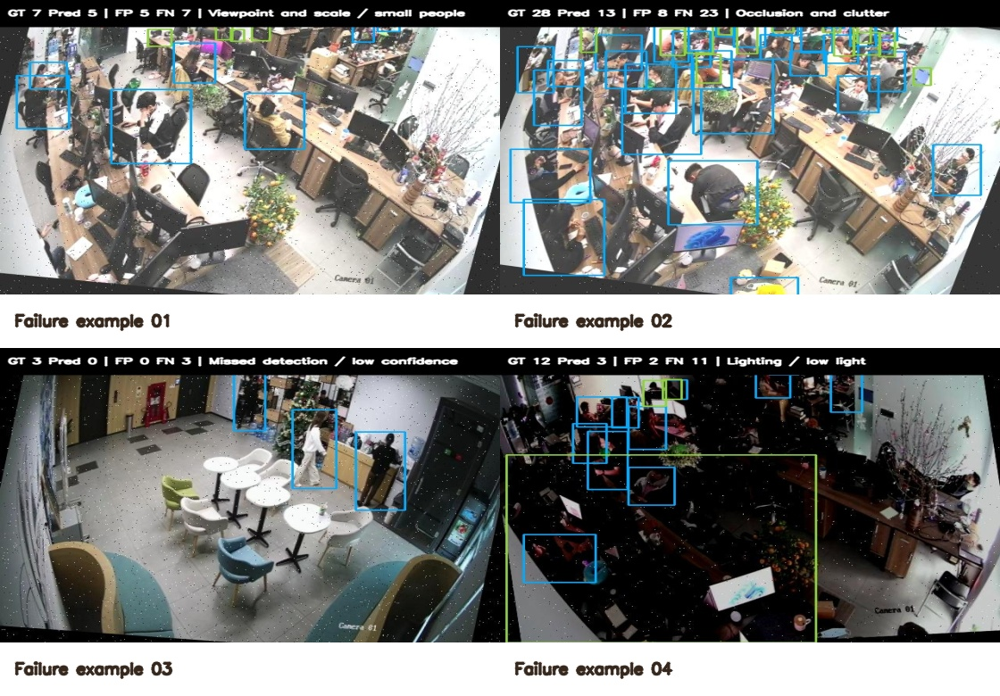

# Operating conditions and limitations

## Supported operating conditions

- Stable phone/laptop/CCTV camera with the lens clean and approximately level.
- Even front lighting; avoid strong backlight and very dark scenes.
- Visible head/upper body and limited overlap between people.
- People should not be extremely small; the evaluation's small-person warning begins below 1.2% of image area.
- Use the detection-area control to exclude mirrors, posters, roads, shelves, or unrelated rooms.

## Measured limitations

| Condition | Images | Precision | Recall | F1 | Count MAE |
| --- | ---: | ---: | ---: | ---: | ---: |
| Dense crowd / occlusion | 36 | 0.5685 | 0.1350 | 0.2181 | 13.0278 |
| Low light | 13 | 0.4118 | 0.0824 | 0.1373 | 5.2308 |
| Partial person at edge | 11 | 0.8333 | 0.2439 | 0.3774 | 2.6364 |
| Small or distant people | 56 | 0.4904 | 0.1771 | 0.2602 | 3.4286 |
| Standard indoor view | 17 | 0.3077 | 0.1481 | 0.2000 | 1.0588 |

The condition table is generated from the frozen test set. Dense crowd/occlusion contributes the largest absolute errors. Low light suppresses scores and detail. Small/distant people may be below the input resolution. Printed people, mirrors, dolls, bedding, furniture, and isolated body regions are important negative examples for the next training round.

## Example evidence

Blue/green boxes in the generated gallery preserve the mismatch. Full records and causes are in `outputs/milestone4_final/failures.csv`, `failure_counts.json`, and `IMPROVEMENT_PLAN.md`.

## Metric boundary

The reproducible metrics describe `src/pipeline.py` with the bundled YOLOX ONNX model. The GitHub Pages browser application uses MediaPipe plus pose/geometry/temporal verification. Its displayed percentage is a confidence score, not system accuracy, and must not be compared directly with the Python test metrics.
