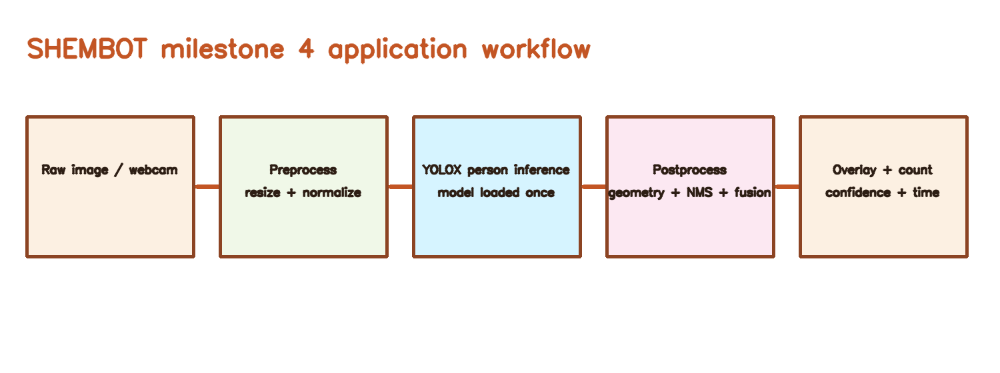
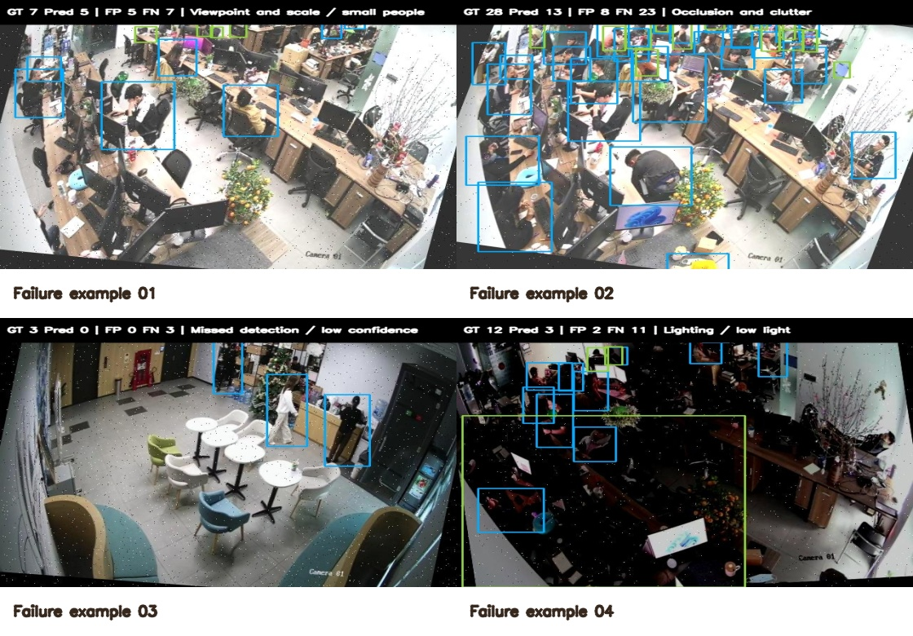

# Milestone 4 - Application, Evaluation, and Documentation

## Executive summary

SHEMBOT now exposes the complete Python person-detection pipeline through an editable Gradio interface. An operator can upload or capture an image and receive the annotated output, confidence values, person count, and processing time. The YOLOX model is cached and warmed once instead of being reloaded per request. The existing mobile-first GitHub Pages application remains the public live demonstration.

The source-grouped test split is frozen at 133 images and 1,056 person boxes. Seed 42, the exact model SHA-256, and all parameters are written to `outputs/milestone4_final/metrics.json`.

## 1. Problem and objectives

The project counts people locally without uploading camera frames. Milestone 4 adds a usable Python interface, a pre-written test plan, reproducible evaluation, condition-level analysis, limitations evidence, slides, and a backup demonstration.

## 2. Data and frozen test protocol

- Test split: 133 images / 1,056 boxes, split by source and left untouched during parameter selection.
- Model: `evaluation\models\object_detection_yolox_2022nov_int8.onnx` (8.659 MB).
- SHA-256: `01a3b0f400b30bc1e45230e991b2e499ab42622485a330021947333fbaf03935`.
- Random seed: 42; matching IoU 0.50.
- Primary detector metric: F1 with AP50 and mAP50-95; counting metric: MAE.

## 3. Application and workflow



`src/gradio_app.py` calls the same `PersonPipeline` used by `run.py`. `get_pipeline()` is cached, and `create_demo()` warms the model before serving. The response contains the overlay, total people, per-box confidence, processing milliseconds, and FPS.

## 4. Reproducible results

| Method | Precision | Recall | F1 | AP50 | mAP50-95 | Count MAE | FPS |
| --- | ---: | ---: | ---: | ---: | ---: | ---: | ---: |
| Single-scale baseline | 0.5984 | 0.0720 | 0.1285 | 0.0619 | 0.0283 | 7.0000 | 2.25 |
| Multi-scale core | 0.5308 | 0.1468 | 0.2300 | 0.1166 | 0.0473 | 5.8346 | 0.44 |

The multi-scale method increases recall, F1, AP50, mAP50-95, and count accuracy versus the single-scale baseline, but costs speed. Checkpoint 4 intentionally keeps the checkpoint-3 detector weights and thresholds fixed, so the measured model metrics do not change from the previous reproducible result. The progress in this checkpoint is application integration, deterministic metadata, condition breakdown, and testing. Browser-only strict verification changes are not mixed into this Python table.

## 5. Condition breakdown

| Condition | Images | Precision | Recall | F1 | Count MAE |
| --- | ---: | ---: | ---: | ---: | ---: |
| Dense crowd / occlusion | 36 | 0.5685 | 0.1350 | 0.2181 | 13.0278 |
| Low light | 13 | 0.4118 | 0.0824 | 0.1373 | 5.2308 |
| Partial person at edge | 11 | 0.8333 | 0.2439 | 0.3774 | 2.6364 |
| Small or distant people | 56 | 0.4904 | 0.1771 | 0.2602 | 3.4286 |
| Standard indoor view | 17 | 0.3077 | 0.1481 | 0.2000 | 1.0588 |

The best F1 occurs for partial people at the frame edge; dense crowds have the largest count error. Low-light recall is only 0.0824. This confirms that lighting, small scale, and occlusion are major causes rather than motion alone.

## 6. Test cases

The 12-case record is in `tests/milestone4_test_cases.csv`; 2/12 cases have an exact count. Ten are marked hard. Failed cases are retained as evidence rather than removed from the demonstration.

## 7. Limitations and operating conditions



Recommended conditions are a stationary camera, subjects large enough to occupy at least about 1.2% of the frame, visible upper bodies, even front lighting, limited occlusion, and no printed or screen-displayed people. The current Python CPU method runs at 0.44 FPS (2273.7 ms/image), so it is for evaluation and low-rate monitoring rather than smooth real-time video. The public browser model is a separate on-device runtime and must not be described using these Python metrics.

## 8. Work remaining to 100%

The next iteration will collect phone-camera negatives (toys, posters, furniture, body fragments), add close-up/occluded positives, tune on validation only, reduce multi-scale computation, and repeat the locked test once the candidate is fixed. Owners and target dates are in `docs/remaining.md`.

## 9. Reproduction

```powershell
python -m pip install -r requirements-app.txt
python src/gradio_app.py
python src/evaluate.py --split test --weights evaluation/models/object_detection_yolox_2022nov_int8.onnx --output outputs/milestone4_final
python tools/create_milestone4_assets.py
```

## 10. Conclusion

Milestone 4 supplies one working application, 12 recorded cases, reproducible metrics, condition-level diagnosis, report, slides, and a backup demo. The evidence also shows that the detector is not yet production-ready: recall and CPU speed remain the highest-priority risks.
